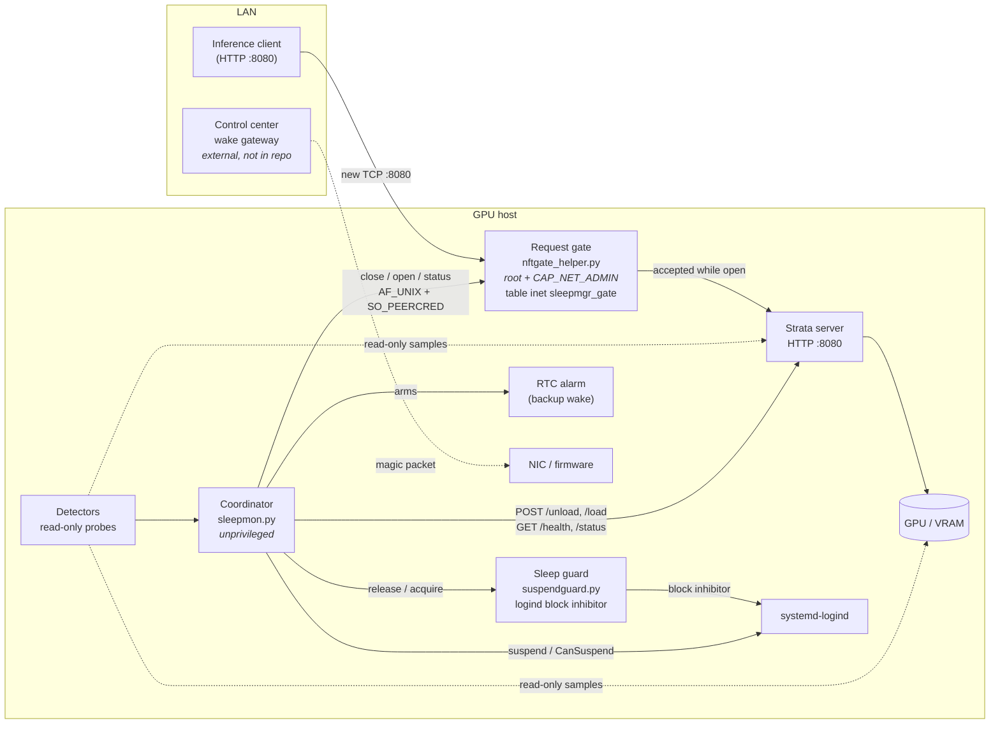
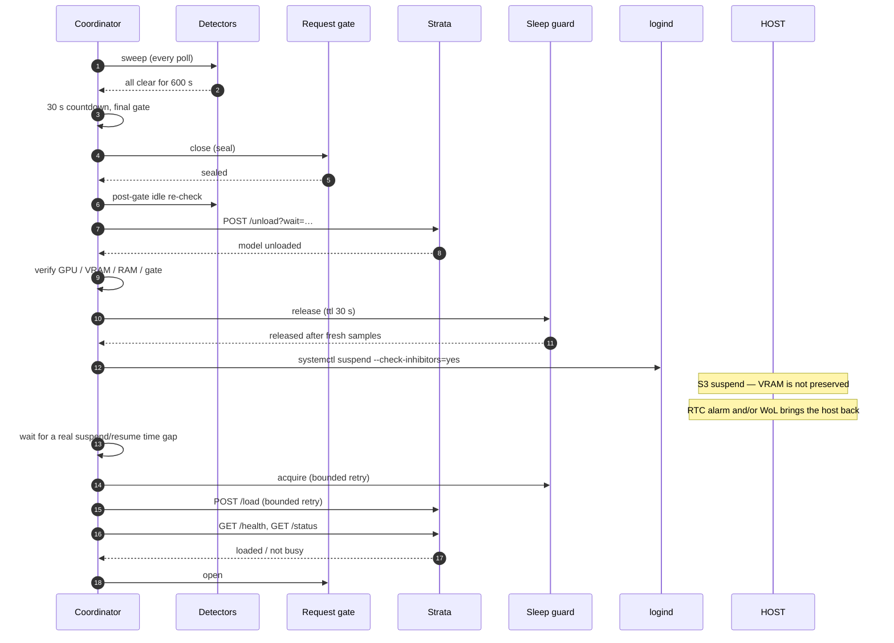

# Architecture

## Roles

| role | process | privilege | responsibility |
|---|---|---|---|
| **Coordinator** | `sleepmon.py` (`sleepmgr.service`) | unprivileged user | decide *when* it is safe, own the state machine, never touch nft or power directly |
| **Detectors** | `detectors.py` | same | read-only probes; unknown means "do not sleep" |
| **Sleep guard** | `suspendguard.py` | unprivileged user | hold a logind `sleep` block inhibitor unless fresh samples prove it is safe to release |
| **Request gate** | `nftgate_helper.py` | root, `CAP_NET_ADMIN` only | own one nftables table; reject *new* remote TCP connections to the inference port |
| **GPU host workload** | Strata server + model | unprivileged user | serve inference on the LAN; unload/reload through its HTTP API |
| **Wake path** | RTC alarm, Wake-on-LAN | firmware/kernel | bring the host back after S3 |
| **Readiness checks** | coordinator + Strata API | unprivileged | prove the model is back before reopening the gate |
| **Control center** | external wake gateway | external host | send the wake and track readiness — **not in this repository** |

Everything except the gate helper runs unprivileged. The coordinator talks to
the helper over a local Unix socket authenticated by `SO_PEERCRED`, and to
Strata over HTTP.

The reference deployment is one GPU host with two Tesla T4 GPUs. The control
center is a separate LAN machine; see
[`docs/wake-gateway.md`](docs/wake-gateway.md) for the gap.

## Component diagram

## Suspend sequence

## Request gate

The gate exists for one race: a request that arrives after the model is
unloaded but before the machine suspends.

- It owns exactly one table, `inet sleepmgr_gate`, one input chain and one rule:
  `tcp dport <inference> tcp flags & (syn|ack) == syn iifname != "lo" … reject
  with tcp reset`.
- It is **stateless** on purpose. `ct state new` can drop the next data packet
  of an already-established flow when conntrack has not seen it yet.
- `iifname != "lo"` keeps loopback open, so the coordinator's own readiness
  probes keep working while the gate is closed.
- `meta skuid` is not used: in an input hook it matched zero packets and turned
  the gate into a silent no-op.
- An ordinary `close` is a **lease** tied to the coordinator's connection: if
  the coordinator dies, the helper reopens the gate. A controlled-suspend
  `seal` is **durable** for the boot: it survives helper stop, crash, restart
  and a coordinator exit, and is only reopened by an explicit `open`, a
  verified emergency opener, or a new boot.

What the gate **cannot** do: revoke an established keep-alive/HTTP-2
connection, or un-deliver bytes that already reached Strata. See
[`docs/inference-gate.md`](docs/inference-gate.md).

## Wake path

- **RTC alarm** — the coordinator arms an alarm before suspending so a
  forgotten host comes back. It is a backup, not a guaranteed wake source.
- **Wake-on-LAN** — readiness is partial: driver wakeup, ACPI `GLAN` and
  NetworkManager `wake-on-lan=default` are configured, but the `Wake-on: g`
  bit needs root and firmware support is unproven. Treat WoL as best-effort.
- **Resume** — `systemctl suspend` returns when logind enqueues the operation,
  not when the machine wakes. Recovery therefore waits for a real
  suspend/resume time gap before touching the guard, NVIDIA or Strata.

## Readiness checks after resume

Recovery is bounded and fail-closed:

1. guard reacquired (retry for `suspend_guard.post_resume_acquire_timeout_s`,
   default 90 s — logind can return `OperationInProgress` for several seconds
   after resume);
2. `POST /load` retried for `strata.recovery_timeout_s` (default 180 s), each
   request bounded by `strata.load_request_timeout_s` (default 120 s); a lost
   reply is re-checked through `/health` and `/status` instead of posting twice;
3. readiness: `/health.loaded == true`, `/status` not busy and `queued == 0`,
   GPU/RAM checks;
4. only then is the gate reopened.

If any step cannot be verified, the gate stays closed and the coordinator
reports the failure instead of pretending the host is ready.

## Trust boundaries

| boundary | control |
|---|---|
| LAN client → gate | new TCP connections only; established flows are not revoked |
| coordinator → gate | `AF_UNIX`, `SO_PEERCRED` uid allow-list, optional HMAC token |
| coordinator → guard | `AF_UNIX`, uid allow-list, optional token, short TTL |
| gate helper → kernel | `CapabilityBoundingSet=CAP_NET_ADMIN`, one table only |
| coordinator → Strata | API key read at runtime from the Strata config, never logged |
| service → system | `NoNewPrivileges`, `ProtectSystem=strict`, `ProtectHome=read-only` |
